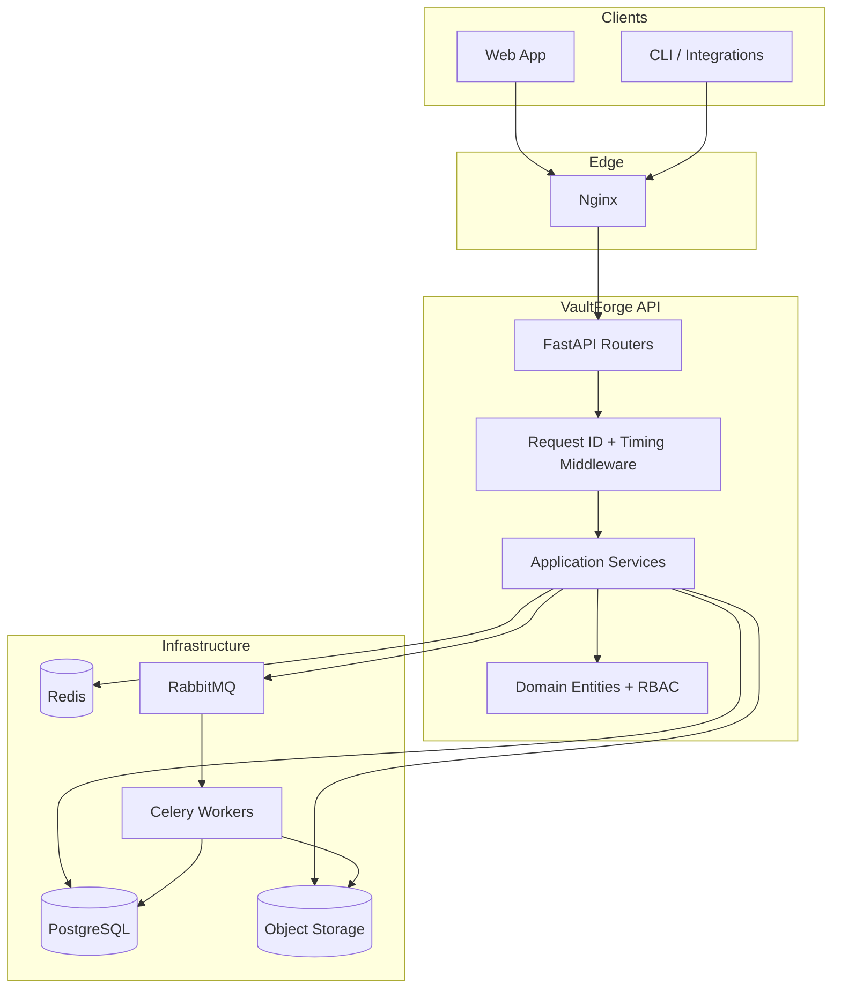

# VaultForge

Enterprise digital asset and document management platform for organizations that need secure storage, version control, approval workflows, e-signatures, and auditable collaboration.

## Features

- **Multi-tenant organizations** with role-based access control (owner, admin, manager, contributor, viewer, auditor)
- **Folder hierarchy** with sensitivity labels and tagging
- **Document versioning** with checkout/checkin locks and SHA-256 integrity checks
- **Approval workflows** and multi-signer signature requests
- **Audit trail** and activity feed with comments, mentions, and notifications
- **Real-time WebSocket** notifications per organization
- **Background workers** (Celery) for async processing
- **REST API** with OpenAPI docs, health/readiness probes, and request tracing

## Stack

| Layer | Technology |
|-------|------------|
| API | Python 3.12, FastAPI, Pydantic v2, Uvicorn |
| Persistence | SQLAlchemy 2.x (async), Alembic, PostgreSQL |
| Cache / broker | Redis, RabbitMQ, Celery |
| Storage | Local filesystem (S3-compatible backend pluggable) |
| Security | JWT (access + refresh), bcrypt passwords |
| Ops | Docker Compose, Nginx reverse proxy |
| Quality | Pytest, Ruff, Black, MyPy, Poetry |

## Architecture



## Quick start

```bash
cp .env.example .env
./scripts/dev_bootstrap.sh          # Linux/macOS
# .\scripts\dev_bootstrap.ps1     # Windows

poetry run vaultforge               # start API on :8000
poetry run python scripts/seed_demo_data.py --dry-run
```

- API docs: http://localhost:8000/docs
- Health: http://localhost:8000/health

## Project layout

```
src/vaultforge/
  api/            HTTP routes, middleware, WebSockets
  application/    Use-case services and DTOs
  domain/         Entities, enums, repository interfaces
  infrastructure/ SQLAlchemy, Redis, Celery, storage
  core/           Config, logging, pagination, exceptions
alembic/          Database migrations
tests/            Unit, integration, e2e
scripts/          Bootstrap, seed data, CI checks
docs/             Setup, development, deployment, API reference
```

## Documentation

- [Setup guide](docs/setup.md)
- [Development guide](docs/development.md)
- [Deployment guide](docs/deployment.md)
- [API reference](docs/api.md)
- [Troubleshooting](docs/troubleshooting.md)
- [Changelog](CHANGELOG.md)

## License

Proprietary - internal enterprise use.
