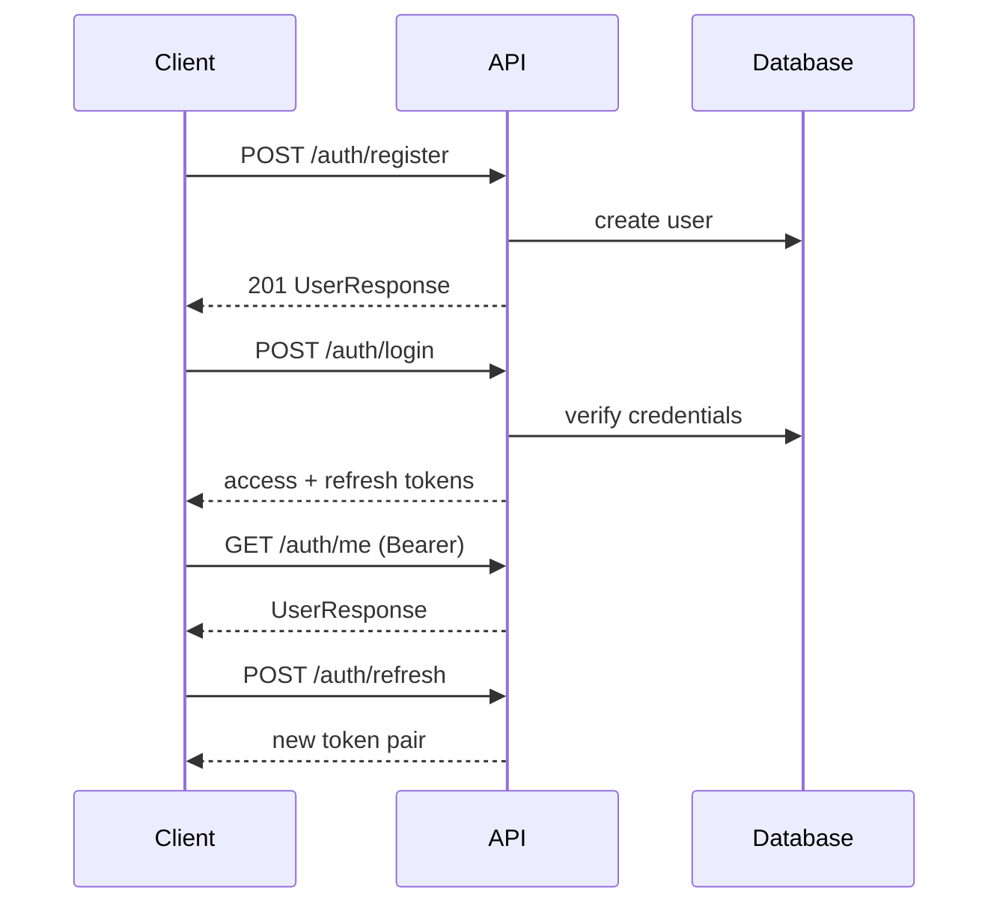

# API Reference

VaultForge REST API v1. Base path: `/api/v1` (configurable via `APP_API_PREFIX`).

Interactive docs: `/docs` (Swagger UI) and `/redoc`.

## Authentication

VaultForge uses **JWT bearer tokens**.

### Register

```http
POST /api/v1/auth/register
Content-Type: application/json

{
  "email": "user@example.com",
  "password": "SecurePass123!",
  "full_name": "Jane Doe"
}
```

Returns `201` with user profile (no tokens — login separately).

### Login

```http
POST /api/v1/auth/login
Content-Type: application/json

{
  "email": "user@example.com",
  "password": "SecurePass123!"
}
```

Response:

```json
{
  "access_token": "<jwt>",
  "refresh_token": "<jwt>",
  "token_type": "bearer"
}
```

Access tokens expire in 30 minutes (default). Refresh tokens expire in 14 days.

### Refresh

```http
POST /api/v1/auth/refresh
Content-Type: application/json

{ "refresh_token": "<jwt>" }
```

### Authenticated requests

```http
GET /api/v1/auth/me
Authorization: Bearer <access_token>
```

### Auth flow diagram



## Error format

All application errors return JSON:

```json
{
  "code": "not_found",
  "message": "Resource not found"
}
```

FastAPI validation errors (`422`) use standard Pydantic `detail` array.

| HTTP | code | Meaning |
|------|------|---------|
| 400 | `vaultforge_error` | Generic application error |
| 401 | `unauthorized` | Missing/invalid token or bad credentials |
| 403 | `forbidden` | Insufficient permissions or inactive membership |
| 404 | `not_found` | Resource missing |
| 409 | `conflict` | State conflict (duplicate, checkout lock) |
| 422 | `validation_error` | Business rule validation failure |

## Main endpoint groups

### Organizations — `/api/v1/organizations`

| Method | Path | Permission | Description |
|--------|------|------------|-------------|
| POST | `/organizations` | authenticated | Create org (caller becomes owner) |
| GET | `/organizations` | authenticated | List caller's organizations |
| GET | `/organizations/{id}` | member | Get organization |
| PATCH | `/organizations/{id}` | `org:manage` | Update organization |
| POST | `/organizations/{id}/members/invite` | `user:manage` | Invite member |
| GET | `/organizations/{id}/members` | `user:manage` | List members |

### Teams — `/api/v1/organizations/{org_id}/teams`

Team CRUD and membership management (`team:manage`).

### Folders — `/api/v1/organizations/{org_id}/folders`

Folder tree operations (`folder:create`, `folder:manage`).

### Documents — `/api/v1/organizations/{org_id}/documents`

| Method | Path | Description |
|--------|------|-------------|
| POST | `/documents` | Multipart upload (new document + v1) |
| GET | `/documents/{id}` | Get metadata + current version |
| POST | `/documents/search` | Filter by name, tags, folder, status |
| POST | `/documents/{id}/versions` | Upload new version |
| POST | `/documents/{id}/checkout` | Acquire edit lock |
| POST | `/documents/{id}/checkin` | Release edit lock |
| DELETE | `/documents/{id}` | Soft delete |

### Workflows — `/api/v1/organizations/{org_id}/workflows`

Approval workflow definitions and instances (`workflow:manage`, `workflow:approve`).

### Signatures — `/api/v1/organizations/{org_id}/signatures`

Signature request lifecycle (`signature:request`, `signature:sign`).

### Audit & activity

- `/api/v1/organizations/{org_id}/audit` — immutable audit events (`audit:read`)
- `/api/v1/organizations/{org_id}/activity` — user-facing activity feed

### Collaboration

- `/api/v1/organizations/{org_id}/comments` — threaded comments with @mentions
- `/api/v1/organizations/{org_id}/notifications` — in-app notifications

### Settings & admin

- `/api/v1/organizations/{org_id}/settings` — org defaults (`settings:manage`)
- `/api/v1/organizations/{org_id}/admin` — admin operations

### Search, reports, analytics

- `/api/v1/organizations/{org_id}/search` — cross-resource search
- `/api/v1/organizations/{org_id}/reports` — compliance reports (`report:read`)
- `/api/v1/organizations/{org_id}/analytics` — usage metrics

## WebSockets

### Organization notifications

```
WS /ws/organizations/{organization_id}/notifications
```

- Server pushes notification events to connected clients
- Client may send heartbeat messages (received as text, ignored)
- Authenticate at connection time in production (JWT query param or cookie — implement at gateway)

Connection managed by `api/ws/manager.py` (in-memory; use Redis pub/sub for multi-instance).

## Health (unauthenticated)

| Path | Description |
|------|-------------|
| `GET /health` | Liveness + version |
| `GET /ready` | Readiness (optional dependency check) |
| `GET /health/deps` | Postgres + Redis status |
| `GET /metrics` | Prometheus-style metrics |

## Request headers

| Header | Direction | Purpose |
|--------|-----------|---------|
| `Authorization` | Request | `Bearer <access_token>` |
| `X-Request-ID` | Both | Correlation ID (auto-generated if absent) |
| `X-Response-Time-Ms` | Response | Server processing time |
| `X-User-Id` | Request | Dev-only user override on document routes |

## Pagination

List endpoints accept `page` and `page_size` query parameters (or offset/limit in search bodies). Responses use:

```json
{
  "items": [],
  "total": 0,
  "page": 1,
  "page_size": 50,
  "pages": 0
}
```

## Rate limiting

Not enforced in application code — configure at Nginx or API gateway in production.
